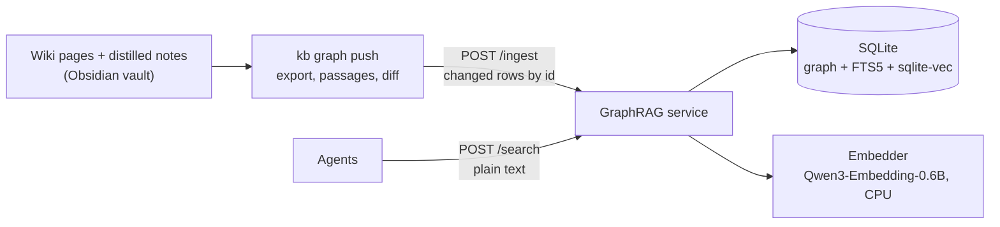

# obsidian-graph-rag

A small GraphRAG service, and a reference client that feeds it from an LLM-maintained wiki.

- **`src/graphrag_service/`** is the service: one Python process holding a graph, a keyword
  index and a vector index in a single SQLite file, with an HTTP API for ingest and search.
  It makes no LLM calls and knows nothing about where its data comes from: no vault path, no
  git, no Markdown. Rows arrive over HTTP with stable ids. **[docs/api.md](docs/api.md)** is
  the full API reference.
- **`skills/kb-tools/`** is one client: `kb.py`, a deterministic tool for an LLM wiki kept in
  an Obsidian vault (lint, source ledger, graph export), and `kb graph push`, which sends what
  changed to the service.
- **[docs/skill-prompts.md](docs/skill-prompts.md)** has prompts for building the agent
  skills that write such a wiki. The skills themselves are not here: they depend on your
  notes, your entities and your conventions, so you generate your own.

> **This repo holds code only.** The indexed content is private. Never commit vault notes,
> exported graph rows, the golden set, tokens, or anything under `data/`. `.gitignore` blocks
> `data/`, `*.db`, `*.jsonl`, `tokens.json` and `client.json`; keep it that way.



## Run the service

Needs Python 3.12 and [uv](https://docs.astral.sh/uv/).

```powershell
uv sync
uv run graphrag token add kb --scope read --scope ingest   # prints the token once
uv run graphrag serve                                      # 127.0.0.1:8787
```

On Windows, `scripts/start-service.ps1` runs it with logging to `data/service.log`, and
`scripts/install-service.ps1` registers a per-user scheduled task that starts it at logon.

| Setting | Default | |
|---|---|---|
| `GRAPHRAG_DATA_DIR` | `./data` | SQLite file, tokens, access log |
| `GRAPHRAG_HOST` / `GRAPHRAG_PORT` | `127.0.0.1` / `8787` | Keep it on localhost; see Security |
| `GRAPHRAG_MODEL` | `Qwen/Qwen3-Embedding-0.6B` | `hash` selects a dependency-free test embedder |
| `GRAPHRAG_EMBED_THREADS` / `GRAPHRAG_EMBED_BATCH` | `8` / `8` | |
| `GRAPHRAG_RATE_PER_MINUTE` | `240` | Per read token |

Changing the model drops every vector and re-embeds on the next start.

## Ingest API

Rows are generic. Six kinds, each addressed by a string `id` the client chooses:

| Kind | Fields besides `id` |
|---|---|
| `nodes` | `name`, `type`, `domain`, `aliases[]`, `summary`, `path`, `url`, `attrs{}` |
| `edges` | `src`, `predicate`, `dst`, `inverse`, `text`, `marker`, `date`, `since`, `authors[]`, `sources[]`, `superseded` |
| `claims` | `subject`, `text`, `section`, `marker`, `date`, `since`, `authors[]`, `sources[]`, `mentions[]`, `superseded` |
| `sources` | `path`, `url`, `domain`, `date`, `summary`, `origins[]`, `entities[]` |
| `documents` | `path`, `kind` (`wiki` or `raw`), `title`, `note_date`, `domain`, `url` |
| `passages` | `doc_id`, `ord`, `heading`, `text`, `nodes[[node id, via]]` |

Every row may carry a `hash`; the service stores it and gives it back.

| Endpoint | |
|---|---|
| `GET /ingest/manifest` | `{kind: {id: hash}}` for everything stored, so a client can diff |
| `POST /ingest` | `{"upsert": {kind: [rows]}, "delete": {kind: [ids]}, "replace": false, "state": {...}}` |

One request is one transaction: a bad row rolls the whole batch back. `replace: true` deletes
everything not in the batch. `state` is the client's own note (revision, export status,
backlog) and comes back in `/status` and in every search response. Ingest returns at once;
embedding happens in the background, and `pending_embeddings` says how far along it is. Rows
are keyword-searchable immediately and vector-searchable once embedded.

## Search API

All endpoints except `/healthz` need `Authorization: Bearer <token>`.

| Endpoint | |
|---|---|
| `POST /search` | Plain text in; ranked claims, edges, entities, passages and paths out |
| `GET /entities/{name}` | One entity by name or alias: summary, current claims, edges |
| `GET /entities/{name}/neighbors?predicate=` | Connected entities |
| `GET /open?entity=&owner=&older_than_days=` | Current `open` claims, oldest first |
| `GET /documents?path=` | The passages of one document |
| `GET /status` | Counts, pending embeddings, model, the client's state |
| `GET /healthz` | Liveness, no token |

```json
{"query": "who owns the trigger channel now?", "mode": "hybrid", "top_k": 8, "max_tokens": 3000,
 "filters": {"types": ["person"], "after": "2026-08-01", "domain": "enterprise",
             "markers": ["fact", "decision"], "include_raw": true},
 "include_superseded": false}
```

Only `query` is required. Every claim and edge comes back with its `marker`, `date`,
`authors`, `sources` and `superseded` flag, and `sources` maps each cited source page to its
path, link and original notes. Superseded claims and edges are left out unless asked for.

### Modes

| Mode | What it does |
|---|---|
| `vector` | Passages only, by embedding similarity |
| `hybrid` (default) | Passages, claims, edges and entities; vector and FTS5 lists fused by reciprocal rank |
| `graph` | `hybrid`, then Personalized PageRank over entities and passages re-ranks everything |

`graph` follows HippoRAG 2: entities named in the query, and the entities behind the best
claims and edges, seed a walk over typed edges, mentions and passage links (damping 0.5,
passage seeds weighted 0.05). Walk scores are divided by the square root of degree, so a hub
that everything links to does not win on size. Each kind is then ranked by reciprocal-rank
fusion of the plain retrieval order and the walk's order, so a simple lookup still returns
what retrieval alone would. `paths` lists chains of two or three edges from the entities the
query names to the ones the walk ranked highest.

A response holds up to `2 * top_k` claims, `2 * top_k` edges, `top_k` entities and `top_k`
passages, cut to `max_tokens` (an estimate: 1.3 per word, 1 per CJK character). Claims and
edges are filled first and may use up to 60% of the budget.

Chinese keyword search works by rewriting runs of CJK characters as overlapping bigrams
before indexing and querying; FTS5's own tokenizers cannot match two-character words.

## Security

The index holds whatever was pushed into it, so treat the service as private.

- It binds to `127.0.0.1`. Do not change that without an authenticating tunnel in front.
- Tokens have scopes: `read` for search, `ingest` for writes. Only SHA-256 digests are
  stored. `--domain public` restricts a token to rows of one domain.
- `data/access.log` records token name, endpoint, status and result count. Never the query.

## Pushing from the wiki

```bash
python skills/kb-tools/kb.py graph push            # what changed since the last push
python skills/kb-tools/kb.py graph push --full     # everything, and drop the rest
python skills/kb-tools/kb.py graph push --dry-run  # counts only
```

Run from the vault root, or set `OBSIDIAN_VAULT`. URL and token come from `--url`,
`KB_GRAPHRAG_URL` / `KB_GRAPHRAG_TOKEN`, or `~/.kb/graphrag.json` (`{"url": ..., "token": ...}`).

- The push exports the wiki with the same parser `kb lint` uses. If any line does not parse,
  nothing is sent, the service keeps its last good index, and `export_ok: false` shows in
  `/status`.
- Passages come from wiki pages (split by heading) and from source notes the ledger marks
  `distilled` (Markdown, and HTML cleaned to text). Notes the wiki has not ingested are never
  sent.
- It will not run while another wiki writer holds `kb lock`. Inside a writer's own run, pass
  `--by <skill>`. Exit codes: `0` ok, `1` wiki does not parse, `3` lock busy, `4` service
  unreachable.
- A rename is a delete plus an insert; a deleted page takes its claims, edges and passages
  with it.

Skills that write to the wiki should end with a push, inside their own lock. See
[docs/skill-prompts.md](docs/skill-prompts.md).

## Evaluation

`eval/run_eval.py --golden <file>` runs a golden set against a live service and reports, per
mode and question kind, recall of the expected entities, answer-term hits and response size.
The golden set is written from private content and stays with it.

First run, 40 questions (10 each of single-fact, multi-hop, temporal and broad; 10 in Chinese)
over a private wiki of a few thousand claims and passages, `top_k=8`, `max_tokens=3000`.
Recall is the share of expected entities present anywhere in the response:

| Mode | Fact | Multi-hop | Temporal | Broad | All | Answer terms | Tokens | Median latency |
|---|---|---|---|---|---|---|---|---|
| `vector` | 0.90 | 0.30 | 0.60 | 0.47 | 0.57 | 0.57 | 1,751 | 332 ms |
| `hybrid` | 1.00 | 0.95 | 1.00 | 0.96 | 0.98 | 0.80 | 2,895 | 141 ms |
| `graph` | 1.00 | 0.90 | 1.00 | 0.93 | 0.96 | 0.82 | 2,844 | 137 ms |

`graph` was to become the default only if it beat `hybrid` on multi-hop and temporal questions
without losing on single-fact lookup. It does not, so `hybrid` is the default. `graph` returns
somewhat better passages (passage-only recall 0.64 against 0.56) and is the only mode that
returns `paths`. With ten questions per kind, one question moves a cell by 0.10, and `hybrid`
at this budget is close to the ceiling, so the set cannot separate the two modes finely.

## Tests

```bash
uv run pytest            # service tests (synthetic data, hash embedder) and kb tool tests
```

## Measured on a 16-thread CPU, no GPU

| | Qwen3-Embedding-0.6B | Qwen3-Embedding-4B |
|---|---|---|
| Load | 4 s | 51 s |
| Short texts (~25 tokens) | 18 /s | 2.9 /s |
| Passages (~450 tokens) | 1.3 /s | 0.2 /s |
| Query embedding | 190 ms | 940 ms |

float32, 8 threads; the checkpoints ship as bfloat16, which is about 2.5 times slower on CPU.
0.6B is the default. `scripts/spike_embed.py` reproduces the numbers.
