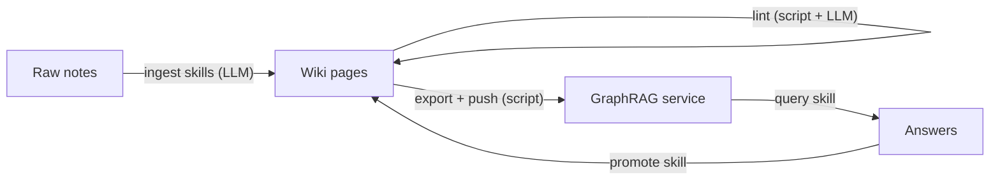

# Prompts for building your own wiki skills

The service in this repo only searches what is pushed into it. Something has to build the
graph first: decide what an entity is, read your notes, write claims with sources, and keep
that up to date. That part is specific to you, so this repo does not ship it. It ships
prompts instead: hand them to a coding agent, with your answers filled in, and it writes
skills that fit your notes.

The pattern behind them is the "LLM wiki": an agent incrementally maintains a set of
interlinked pages distilled from your raw notes. The raw notes stay the source of truth, the
wiki is the synthesis, and a deterministic script turns the wiki into graph rows. No LLM
runs in the search service.



## 1. Decide these first

The prompts refer to your answers as `<placeholders>`. Write the answers down once; every
prompt needs the same ones.

| Question | Why it matters |
|---|---|
| Where do the notes live, and in what formats? (`<notes root>`) | Sets what the tool walks and what the passage builder must parse |
| Which folders are sources, and which are off limits? (`<source folders>`) | A whitelist is the privacy boundary: only whitelisted, ingested notes ever reach the index |
| What kinds of entity do you care about? (`<entity types>`) | People, projects and concepts suit engineering notes; a researcher may want papers, methods and datasets |
| Which relationships matter between them? (`<predicates>`) | A small closed vocabulary keeps the graph queryable. Fifteen to twenty-five, each with an inverse name and the entity types allowed at each end, plus one catch-all |
| How do you want confidence expressed? (`<markers>`) | For example fact / decision / inferred / claim / open. The search service passes markers through and lists `open` ones |
| Is there a public / private split? (`<domains>`) | Lets callers filter search to public pages |
| How do notes arrive: daily journal, one-off documents, web clippings, generated reports? | Decides whether you need a per-note ingest, a batched one, or both |
| How much may run unattended, and how do you want to hear about it? | Scheduled runs need a budget per run and a report |
| Where does the wiki live, and what link syntax does it use? (`<wiki root>`) | Wikilinks, Markdown links, or something else |

## 2. Build order

Each step depends on the ones before it. Stop after any step and you still have something
useful.

| Step | What you get |
|---|---|
| A. Schema | A written convention for pages, markers and relationships |
| B. Tool | A script that lints the wiki, tracks which notes are ingested, and exports the graph |
| C. Ingest skill | An agent procedure that turns named notes into wiki pages |
| D. Scheduled ingest | The backlog and new notes handled without you |
| E. Lint skill | Stale questions, contradictions and thin pages revisited on a schedule |
| F. Query and promote skills | Answers from the wiki, and good answers filed back into it |
| G. Push | The wiki searchable through this service |

## 3. The prompts

Replace every `<placeholder>`. Give the agent access to the notes and a few representative
samples, and let it ask questions before it writes anything.

### A. Schema

```text
I keep notes in <notes root>. I want an LLM-maintained wiki in <wiki root> that distils them
into interlinked pages, and that a script can parse into a knowledge graph with no LLM.

Write the schema document for that wiki at <wiki root>/_schema.md. It is the single place
every skill reads before writing, so it must be complete and unambiguous.

Entity types: <entity types>, one folder each. Also a `sources` folder (one page per ingested
note or batch, recording which raw notes it came from and which entities it yielded) and a
`syntheses` folder (answers worth keeping).

Specify:
- Frontmatter for each page type: title, type, <domains>, dates, aliases, the list of source
  pages, and any structured fields worth having (ask me which).
- The body layout: a one-paragraph summary, then sections for statements, open questions,
  relationships and sources.
- The statement grammar: one statement per bullet, ending with a citation of the source page
  and a confidence marker from <markers>, then an optional date and author in a fixed
  format. ISO dates only. Define each marker precisely, with an example of when not to use it.
- How a statement that stops being true is kept and marked superseded with a date, never
  deleted.
- The relationship grammar: one target per line, predicate first, from this closed
  vocabulary: <predicates>. For each predicate give its inverse and the entity types allowed
  at each end. Include one catch-all predicate and say it is the last resort.
- Naming rules: how a page is named, how aliases work, what happens on rename.
- What must never enter the wiki (<off-limits folders and topics>).
- The index page and the append-only log page, with exact entry formats.

Every rule must be checkable by a script, or be clearly labelled as needing judgment. Show
one complete example page per type. Read these sample notes first: <samples>. Ask me about
anything my notes make ambiguous before you write.
```

### B. Tool

```text
Write a command-line tool, standard library only, that is the deterministic half of the wiki
described in <wiki root>/_schema.md. Every skill will call it, so it must be fast and its
output must be easy for an agent to read. Include tests that build a small fake wiki in a
temp folder.

Commands:
- `sources status`: compare a ledger file with <source folders> and list notes that are new,
  changed, renamed or deleted. Hash content so that line endings and the tool's own
  bookkeeping do not look like edits. Ignore sync-conflict copies and near-empty files.
- `sources mark`: record that a note was distilled into a named source page, or skipped with
  a one-line reason. The ledger is only ever written through this command.
- `lint [--fix]`: every mechanical rule in the schema: frontmatter, broken links, index
  coverage, alias clashes, statement and relationship grammar, predicate vocabulary and
  types, source back-references. `--fix` repairs only what is safe (counts, index entries,
  back-references). Exit non-zero on any error.
- `graph export`: parse the wiki into nodes, typed edges, claims and sources as JSON lines.
  Use the same parser as lint, so that a clean lint means the graph builds. Collapse a
  relationship written on both pages into one edge. Refuse to export if any line fails to
  parse.
- `stats`: open questions with age and owner, single-source pages, orphans, stale pages.
- `lock acquire|release|status`: one writer at a time on this machine, stored outside the
  notes folder, expiring after two hours.

The schema and this tool must agree. Where they do not, tell me which one to change.
```

### C. Ingest skill

```text
Write an agent skill, `<prefix>-distill`, that ingests the notes I name into the wiki. Read
<wiki root>/_schema.md and the tool's help first; the skill must tell the agent to read the
schema at run time rather than repeat it.

The skill's procedure:
1. Take the writer lock; stop if another run holds it.
2. Read the index and the existing pages the note touches, before writing anything.
3. Read the source in full. Extract <entity types> under these inclusion rules: <who and
   what counts; ask me>.
4. Write one source page, then create or update entity pages. Updating means integrating
   into the existing prose and bullets, not appending a dated block. When a new statement
   contradicts an old one, keep both: mark the old one superseded, or raise a visible
   contradiction note if it is not clear which is right.
5. Give every statement a marker, a citation and, where known, a date and author. Classify
   <domains> conservatively.
6. Record the note in the ledger, run lint with --fix until it reports zero errors, append
   to the log, push to the search index, release the lock.
7. Report what was created and updated, with links.

Guardrails to state plainly: never edit a source note beyond one optional backlink line;
never invent an identity from a first name; never ingest from outside <source folders>; never
finish with lint errors.

Add separate guidance for each source format I use: <formats, e.g. long HTML reports, web
clippings, meeting notes>. End with one short worked example using invented names.
```

### D. Scheduled ingest

```text
Write a skill, `<prefix>-ingest-pending`, that runs unattended on a schedule and brings the
wiki up to date with <source folders>.

It runs `sources status`, then for each pending note decides: distill it (following the
<prefix>-distill procedure for that folder's kind of note), or skip it with a recorded
reason so it is not reconsidered every run. For a changed note it reads the difference and
re-distils only if the change is material. For a deleted or renamed note it updates the
source page and reports every page that now rests on a missing source; it never deletes wiki
content on its own.

Budget: at most <N> distilled notes per run, newest first; skips and renames do not count.
It must be silent when there is nothing to do, and otherwise end with a report I can read in
a minute: distilled, skipped and why, contradictions raised, what is left.

<If you keep a daily journal:> Also write `<prefix>-distill-<period>`, which ingests one
<week> of journal notes as a single batch into one source page. A journal repeats itself:
the same item is carried from day to day. Tell the agent to collapse each such chain to its
final state and record when it started, not to write one statement per day. Tell it how to
treat any machine-generated sections of my journal: <describe them> are a summariser's
reading, not something I witnessed, and take the inferred marker.
```

### E. Lint skill

```text
Write a skill, `<prefix>-lint`, that health-checks the wiki on a schedule. Two tiers.

Mechanical: run the tool's lint with --fix, then fix by hand what remains.

Reading, which needs judgment:
- Open questions older than <30> days: search newer sources for an answer. If answered,
  change the marker and cite the answering source. If overtaken, mark it superseded.
  Otherwise list it by owner and age.
- Contradiction notes: revisit each against sources added since.
- Pages resting on a single source: connect them, merge them into a parent, or list them.
- Likely duplicate entities: propose merges; never merge unattended.
- Names that appear on several pages with no page of their own.
- <If you have a public domain:> reread public pages for private detail.

It fixes what is unambiguous, reports the rest most-actionable first, logs the run, and
compares the wiki's numbers with the previous run.
```

### F. Query and promote skills

```text
Write a skill, `<prefix>-query`, that answers my questions from the wiki. It reads the index,
then the pages the question touches, then follows relationships one hop, and follows a
statement back to its raw note when wording, a number or a date matters. It checks how
current the wiki is and says so when part of an answer comes from notes not yet ingested.

Answers must link to the pages and notes they rest on using <link format>, and must keep the
confidence markers: something marked inferred or claim is reported as someone's reading or
position, never as plain fact. Open questions are reported as open, with owner and age.

When the search service is running it may call POST /search (see docs/api.md) to find the
relevant pages and statements faster, and must still read the pages before answering.

Then write `<prefix>-promote`, which files a worthwhile answer (a comparison, a timeline, an
analysis that drew on several pages) as a syntheses page citing its sources, links it from
the entity pages it is about, indexes and logs it. `<prefix>-query` offers this when an
answer drew on three or more pages.
```

### G. Push

```text
Add a `graph push` command to the tool that sends the wiki to the GraphRAG service described
in docs/api.md of the obsidian-graph-rag repo. The service must learn nothing about my notes
folder: everything specific to it happens in this command.

- Map the export to the service's six kinds of row. Choose ids that are stable across runs
  and follow the advice under "Choosing ids" in docs/api.md.
- Strip my link syntax to plain text before sending. Give each node and document a `url`
  that opens it in <my notes app>.
- Build passages: split each wiki page by heading into chunks of about 450 tokens, never
  cutting a bullet in half, and tie each passage to the entity whose page it is and to the
  entities it links to. Skip sections that only repeat the edges or list links.
- Optionally also send the raw notes the ledger marks as distilled, as `raw` documents tied
  to the entities their source page yielded. Clean <HTML or other formats> to text first.
  Never send a note the ledger has not marked distilled.
- Diff against GET /ingest/manifest and send one POST /ingest with only what changed, plus a
  `state` naming the revision. Offer --full and --dry-run.
- If the wiki does not parse, send no rows, report `export_ok: false`, and exit non-zero.
- Do not run while another writer holds the lock; inside a writer's own run accept --by.
- A service that is down must not fail an ingest: exit with a distinct code and say so.

Then add a final "push" step to every skill that writes to the wiki.
```

## 4. Things that turned out to matter

- **Change the format before growing the content.** Settle the schema and get lint passing
  on a handful of pages before ingesting a backlog; migrating hundreds of pages is expensive.
- **One parser.** If lint and export share code, "lint passes" means "the graph builds".
- **Per-statement sources.** A page-level source list cannot say which source supports which
  statement, and the search results are only as traceable as the citations.
- **Supersede, never delete.** Dated history is what makes "who owns this now" answerable.
- **A closed predicate vocabulary with an honest catch-all.** A wrong specific predicate is
  worse than a vague true one. Watch the share of catch-all edges; it tells you when the
  vocabulary needs a row.
- **A ledger.** Without a record of which version of which note was ingested, a scheduled
  run cannot tell new from done.
- **A lock.** Two unattended writers on the same index page corrupt each other's work.
- **Unattended runs report.** Each one ends with what it created, changed, skipped and could
  not decide.
- **Keep your skills with your notes.** They fill up with your own names, projects and
  conventions as you revise them, which is the point, and is also why they are not here.
